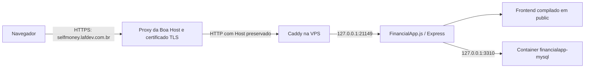

# Arquitetura atual

Atualizado em 09/11/2026. [Índice](INDICE_DOCUMENTACAO.md).

## Acesso público



O DNS `A` de `selfmoney.lafdev.com.br` aponta para `103.204.193.6`. A VPS usa endereço privado internamente e o acesso público passa pela hospedagem. O bloco do Caddy usa explicitamente `http://selfmoney.lafdev.com.br`: forçar um novo redirecionamento HTTPS nessa camada causou `ERR_TOO_MANY_REDIRECTS` e foi corrigido.

## Aplicação e dados

`FinancialApp.js`, na raiz, monta as rotas de `backend/routes`, expõe `/health` e `/health/db` e serve os assets. O frontend React usa a API na mesma origem. O servidor dedicado de IA em `backend/src/index.js` é uma implementação separada e não é o entrypoint de produção.

A aplicação roda como `financialapp` em `financialapp.service`. O MySQL 8.4 usa container e persistência exclusivos. Nenhuma atualização de código reaplica `database/schema.sql`; o bootstrap só o usa uma vez em banco vazio.

## Releases

```mermaid
flowchart LR
    Push[Push em main ou workflow_dispatch] --> CI[GitHub Actions: npm ci, lint e build]
    CI --> SSH[SSH com chave exclusiva e host fixado]
    SSH --> Incoming[/srv/financialapp/incoming]
    Incoming --> Release[Release com dependências de produção]
    Release --> Current[Troca de releases/current]
    Current --> Restart[Reinicia somente financialapp.service]
    Restart --> Health[Página e health/db]
    Health -->|falha| Rollback[Retorna ao código anterior]
```

`financialapp-deploy` tem acesso aos diretórios de release e sudo limitado a reiniciar/parar esse serviço. Não tem autorização para administrar Zaralho, LucFlix ou monitoramento.

## Persistência e limites

| Componente | Local ou limite |
| --- | --- |
| Releases e link ativo | `/srv/financialapp/releases/` e `current` |
| Pacotes recebidos e lock | `/srv/financialapp/incoming/` |
| Script de deploy instalado | `/srv/financialapp/bin/release` |
| Dados MySQL | `/srv/financialapp/shared/mysql` |
| Configuração protegida | `/etc/financialapp/` |
| Aplicação | 512 MiB, até 1 CPU |
| MySQL | 768 MiB, até 0,75 CPU |

O script de deploy preserva releases antigas; uma [automação diária separada](../deploy/vps/README.md), autorizada após a revisão de recursos, mantém a ativa e duas anteriores quando não há referências adicionais. O rollback automático cobre código e depende da compatibilidade com o banco. O deploy não realiza backup ou migração.

Os arquivos em `deploy/` são modelos versionados de infraestrutura. O workflow envia o código da aplicação, mas não reinstala automaticamente scripts de deploy, unidade systemd ou configuração do Caddy. Mudanças nesses componentes exigem aplicação controlada e restrita ao SelfMoney.
